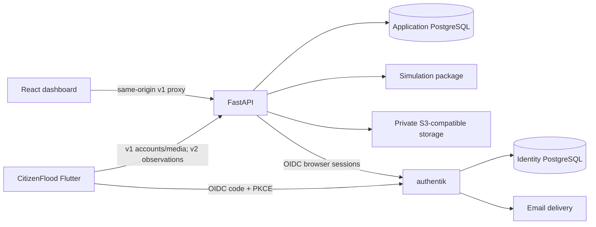

# Architecture and module boundaries

Mobile, web and API are separate deployables. The root uv workspace combines `services/api` and `packages/simulation`; neither client is bundled into the API process.

These interfaces are implemented in source and exercised in synthetic local staging. Production configuration and deployment acceptance are separate gates: the inherited Vercel rewrite still requires cutover to the shared API, and production email, identity provisioning and restore evidence remain required.

| Boundary | Implemented interface | Remaining qualification |
| --- | --- | --- |
| Persistence | `services/api/app/db`; one Alembic chain; separate application/identity databases | Production migration and restore drill |
| Scenarios | Immutable run inputs/artifacts, replay and compatibility checks | Load limits and independent scientific validation |
| Science | `packages/simulation/wwtp_sim`; explicit illustrative model status | Calibration, factor provenance and uncertainty |
| Identity | Shared OIDC issuer; browser sessions; mobile PKCE; capabilities and MFA | Real email, provisioned settings flows, recovery and revocation acceptance |
| Reporting | V2 observation protocol; private media; moderation; redacted public projections; operator response | Device/network acceptance and retention policy |
| Presentation | API-backed dashboard and Flutter repositories | Production proxy/callback and signed mobile acceptance |

The API is a modular monolith owning validation, authorization and persistence. Application roles belong to the API; identity maps uniquely by `(issuer, subject)`. Legacy Supabase configuration and source artifacts are retained for migration/provenance, not as the current authentication architecture. Reviewer/team ownership remains pending in `CODEOWNERS`.

Citizen observations, laboratory measurements, assumptions and model outputs remain distinct data classes. Public community projections omit identity, private notes, precise locations and private media paths. Observations do not automatically become model inputs. See the [roadmap](../migration/ROADMAP.md) and [scientific limits](../science/VALIDATION.md).
